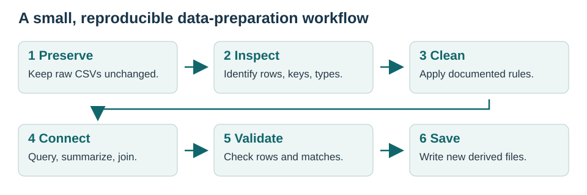
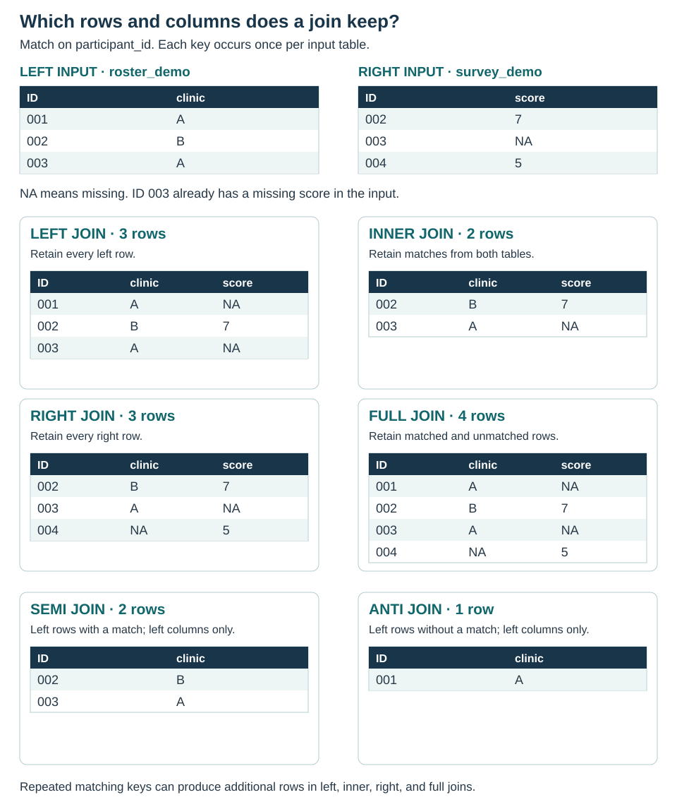
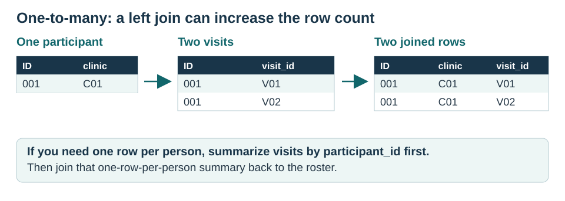

# Data Preparation and Data Engineering {#sec-data-preparation}

## Overview

::: {.callout-note collapse="false" title="The task: build a participant dataset"}

Imagine that you are preparing data for a community-health study. You receive
three files: a participant roster, a clinic lookup table, and a study-visit
extract. Before describing the participants, you need to clean the roster,
connect the files, and confirm that the result still has the intended rows.

**Data cleaning** makes values interpretable and consistent. **Data engineering**
organizes and connects data so those values can be used reliably. In this
chapter, the final dataset will contain **one row per enrolled participant**,
with clinic information and counts of records in the visit extract.

By the end of the walkthrough, you will be able to:

1. Import CSV files while preserving identifiers and raw values.
2. Inspect types, duplicates, missingness, and implausible entries.
3. Rename, recode, and derive variables with readable R code.
4. Select, filter, sort, and summarize data using both dplyr and SQL.
5. Explain and use left, inner, right, full, semi, and anti joins.
6. Check the unit of observation before and after joining tables.
7. Save a prepared dataset and a short record of what changed.

The files are small and entirely fictional. We will prepare data and produce
descriptive summaries; these are **not findings about a real population**.

{#fig-data-workflow width="100%" fig-alt="Six steps: preserve raw files, inspect rows and keys, clean documented values, connect tables, validate rows and matches, and save new derived files."}

:::

## Step 1: Set up the workspace

::: {.callout-note collapse="false" title="Packages, paths, and a few R conventions"}

Open the book's folder in Positron, or its `.Rproj` file in RStudio, to activate renv
(see @sec-environments), then restore the recorded
packages in your **R console** before rendering the book. The lockfile records
R 4.6.2; install R and Quarto separately. This displayed command does not run
during rendering:

```{.r}
renv::restore()
```

`dplyr` transforms data; `sqldf` runs SQL queries on R data frames; `knitr` formats
tables; and `rmarkdown` supports Quarto's R execution. We use base R to read and
write CSV files. Quarto itself is installed separately.

Open the book's folder in Positron or the supplied `.Rproj` file, or start R in the folder containing
`_quarto.yml`. During rendering, `execute-dir: project` makes paths resolve from
that folder. For example, `data/raw/participants.csv` means a file inside this
book, not a location elsewhere on your computer.

```{r}
#| label: setup

options(width = 80)

# Keep SQL examples on the same database engine throughout the chapter.
options(sqldf.driver = "SQLite")

# Use sqldf's R-based string processing without a Tcl/Tk display dependency.
options(gsubfn.engine = "R")
```

You will see a few conventions throughout:

| Notation | Meaning |
|---|---|
| `participants <- ...` | Save a result in an object named `participants`. |
| `dplyr::filter()` | Use `filter()` from the dplyr package. No `library()` call is needed. |
| `data |> function()` | Pass the data on the left into the next function. Read it as “then.” |
| `# ...` | A comment explaining the code or a decision. |
| `NA` | A missing value in R. It is different from zero or the text `"NA"`. |
| `==` | Test equality. Use `<-` to assign an object. |

Run the R chunks from top to bottom. Later examples use objects created earlier.

:::

## Step 2: Import and understand the files

::: {.callout-note collapse="false" title="Begin with the row, the key, and the codebook"}

Download or inspect the [participant roster](../data/raw/participants.csv),
[clinic table](../data/raw/clinics.csv), and [visit extract](../data/raw/visits.csv).
Their complete [codebook](../data/README.md) describes the invented values and
deliberate data problems.

A **key** is a column, or combination of columns, used to identify or connect
records. Before joining anything, state what one row represents:

| File | Intended unit of observation | Key | Connection |
|---|---|---|---|
| Participants | One person | Participant ID | Each person belongs to one clinic. |
| Clinics | One clinic | `clinic_id` | A clinic can have several participants. |
| Visits | One recorded visit | `visit_id` | A participant can have several visits. |

For these small teaching files, import every column as text first. That preserves
IDs such as `"001"` and lets us inspect the recorded values before converting
numeric and date columns. With a larger file, you can instead specify a type
for each column.

```{r}
#| label: import-files

participants_raw <- read.csv(
  "data/raw/participants.csv",
  colClasses = "character",
  na.strings = c("", "NA"),
  check.names = FALSE
)

clinics <- read.csv(
  "data/raw/clinics.csv",
  colClasses = "character",
  na.strings = c("", "NA")
)

visits_raw <- read.csv(
  "data/raw/visits.csv",
  colClasses = "character",
  na.strings = c("", "NA")
)

head(participants_raw)
str(participants_raw)
```

`check.names = FALSE` preserves the roster's original column names, including
spaces. `str()` shows their types. The age column is currently text (`chr`),
which is intentional at this stage. Numeric-looking identifiers should stay
text because arithmetic has no meaning for an ID.

```{r}
#| label: input-counts

input_counts <- data.frame(
  file = c("Participants", "Clinics", "Visits"),
  rows = c(nrow(participants_raw), nrow(clinics), nrow(visits_raw))
)

knitr::kable(input_counts, caption = "Rows received before cleaning")
```

We received `r nrow(participants_raw)` roster rows. A row count is not yet a
participant count: first we need to check whether any rows repeat.

:::

## Step 3: Clean the participant roster

### Give variables readable names

::: {.callout-note collapse="false" title="Create a working copy"}

Use names that are easy to type and explain. `rename()` uses `new_name = old_name`.
Backticks let R refer to an existing name that contains spaces. Assign the result
to a new object so the imported source remains available for comparison.

```{r}
#| label: rename-columns

participants_named <- participants_raw |>
  dplyr::rename(
    participant_id = `Participant ID`,
    clinic_id = Clinic,
    age = Age,
    smoking = Smoking,
    enrollment_date = `Enrollment Date`,
    activity_minutes = `Activity Minutes`
  )

names(participants_named)
```

:::

### Inspect duplicates before removing them

::: {.callout-note collapse="false" title="An identical row is different from a repeated ID"}

First inspect all rows belonging to repeated participant IDs.

```{r}
#| label: inspect-duplicates

duplicate_ids <- participants_named |>
  dplyr::count(participant_id, name = "n_rows") |>
  dplyr::filter(n_rows > 1)

participants_named |>
  dplyr::filter(participant_id %in% duplicate_ids$participant_id)

sum(duplicated(participants_named))
```

Participant 002 appears twice with exactly the same values. In the fictional
source documentation, the second row is a **confirmed duplicate export row**.
We can therefore remove the repeated whole row with `distinct()`.

```{r}
#| label: remove-confirmed-duplicate

participants_unique <- participants_named |>
  dplyr::distinct()

data.frame(
  rows_before = nrow(participants_named),
  rows_after = nrow(participants_unique),
  duplicate_rows_removed = nrow(participants_named) - nrow(participants_unique)
)
```

We now have `r nrow(participants_unique)` rows. Do not use
`distinct(participant_id, .keep_all = TRUE)` to resolve conflicting records
without a reason: it keeps the first row and can silently discard information.
Repeated IDs in a visit table, on the other hand, may represent valid visits.

:::

### Standardize text and convert types

::: {.callout-note collapse="false" title="Make representation consistent before recoding"}

`trimws()` removes surrounding spaces; `tolower()` makes capitalization
consistent. Neither function decides what a response means.

```{r}
#| label: standardize-text

participants_text <- participants_unique |>
  dplyr::mutate(
    participant_id = trimws(participant_id),
    clinic_id = trimws(clinic_id),
    smoking = tolower(trimws(smoking))
  )

table(participants_text$smoking, useNA = "ifany")
```

Next convert age and activity to numbers and enrollment dates to R's `Date`
type. Check the format rather than letting ambiguous dates be guessed.

```{r}
#| label: convert-types

participants_typed <- participants_text |>
  dplyr::mutate(
    age = as.numeric(age),
    activity_minutes = as.numeric(activity_minutes),
    enrollment_date = as.Date(enrollment_date, format = "%Y-%m-%d")
  )

str(participants_typed)

# Converting valid recorded values should not introduce new missing values.
conversion_check <- data.frame(
  variable = c("age", "activity_minutes", "enrollment_date"),
  missing_before = c(
    sum(is.na(participants_text$age)),
    sum(is.na(participants_text$activity_minutes)),
    sum(is.na(participants_text$enrollment_date))
  ),
  missing_after = c(
    sum(is.na(participants_typed$age)),
    sum(is.na(participants_typed$activity_minutes)),
    sum(is.na(participants_typed$enrollment_date))
  )
)

knitr::kable(conversion_check)
stopifnot(conversion_check$missing_before == conversion_check$missing_after)
```

`stopifnot()` stops execution if an expected condition is false. Here it checks
for failed conversions. If this fails on your own data, inspect the original
values and confirm their format; do not just suppress a conversion warning.
This check does not prove that the original dates were recorded correctly.

:::

### Use the codebook to interpret missing and invalid values

::: {.callout-note collapse="false" title="Missing is not zero, and an invalid entry needs review"}

The codebook defines age `999` and activity `-9` as not reported. These meanings
come from this example's documentation, not from the numbers themselves. Recode
only those known sentinel values first.

```{r}
#| label: recode-sentinels

participants_missing <- participants_typed |>
  dplyr::mutate(
    age = dplyr::na_if(age, 999),
    activity_minutes = dplyr::na_if(activity_minutes, -9)
  )
```

Check against the fictional study's documented range rules: ages 18–100 and
activity between 0 and the total minutes in seven days. Flag a value before
changing it, so the reason is visible.

```{r}
#| label: flag-invalid-values

participants_flagged <- participants_missing |>
  dplyr::mutate(
    age_invalid = !is.na(age) & (age < 18 | age > 100),
    activity_invalid = !is.na(activity_minutes) &
      (activity_minutes < 0 | activity_minutes > 7 * 24 * 60)
  )

participants_flagged |>
  dplyr::filter(age_invalid | activity_invalid) |>
  dplyr::select(participant_id, age, activity_minutes, activity_invalid)
```

Participant 009 has an unresolved activity value of −20. We cannot infer the
correct value. For this example, preserve the flag and raw file, and set the
cleaned value to missing. No participant is removed because of missing data.

We also combine documented variants of yes/no. Unknown and refused responses
remain missing; they are not “No.” The raw response is still in
`participants_raw` if we need to distinguish reasons for missingness later.

```{r}
#| label: create-clean-variables

# Stop for a new, undocumented category instead of silently recoding it.
stopifnot(
  all(is.na(participants_flagged$smoking) |
        participants_flagged$smoking %in%
          c("yes", "y", "no", "n", "unknown", "refused"))
)

participants_clean <- participants_flagged |>
  dplyr::mutate(
    age = dplyr::if_else(age_invalid, NA_real_, age),
    activity_minutes = dplyr::if_else(
      activity_invalid, NA_real_, activity_minutes
    ),
    smoking = dplyr::case_when(
      smoking %in% c("yes", "y") ~ "Yes",
      smoking %in% c("no", "n") ~ "No",
      TRUE ~ NA_character_
    ),
    age_group = dplyr::case_when(
      is.na(age) ~ NA_character_,
      age < 40 ~ "18-39",
      age < 60 ~ "40-59",
      TRUE ~ "60-100"
    ),
    age_group = factor(age_group, levels = c("18-39", "40-59", "60-100"))
  )

table(participants_clean$smoking, useNA = "always")
table(participants_clean$age_group, useNA = "always")
colSums(is.na(participants_clean))
```

`case_when()` evaluates conditions from top to bottom; `~` separates a condition
from its replacement. `NA_real_` and `NA_character_` explicitly create numeric
and text missing values. A **factor** stores categories with specified levels,
so age groups display in the intended order. These age cutpoints are teaching
choices, not a required categorization for another analysis.

The cleaned roster has `r sum(is.na(participants_clean$age))` missing age,
`r sum(is.na(participants_clean$smoking))` missing smoking responses, and
`r sum(is.na(participants_clean$activity_minutes))` missing activity values.
Participant 006's reported **zero activity minutes remains zero**.

Finally, verify that participant IDs are present and unique after cleaning.

```{r}
#| label: check-roster-key

stopifnot(
  !anyNA(participants_clean$participant_id),
  all(participants_clean$participant_id != ""),
  anyDuplicated(participants_clean$participant_id) == 0
)
```

:::

## Step 4: Ask questions with dplyr and SQL

::: {.callout-note collapse="false" title="Two ways to express the same operation"}

**SQL** stands for Structured Query Language. With `sqldf::sqldf()`, you write a
SQL query inside an R string. The function copies the referenced R data frames
into a temporary database, executes the query, and returns a new data frame.
No database server is needed for this walkthrough. See the
[sqldf documentation](https://github.com/ggrothendieck/sqldf).

We use SQLite explicitly. SQL syntax differs somewhat between database engines.
The right and full joins later in the chapter require **SQLite 3.39 or later**.
Check the version bundled with your installed RSQLite package:

```{r}
#| label: sqlite-version

sqlite_version <- sqldf::sqldf("SELECT sqlite_version() AS version")
sqlite_version
```

If it is older than 3.39, update `RSQLite` in the R console and restart R. SQLite
added right and full outer joins in its
[3.39 release](https://sqlite.org/releaselog/3_39_0.html).

For the initial queries, use only simple text and numeric columns. Dates and
factors have special R classes; their behavior across database engines deserves
separate attention when you move beyond these examples.

```{r}
#| label: query-table

people <- participants_clean |>
  dplyr::select(participant_id, clinic_id, age, smoking, activity_minutes)
```

| Task | dplyr | SQL |
|---|---|---|
| Choose columns | `select()` | `SELECT` |
| Keep rows meeting a condition | `filter()` | `WHERE` |
| Sort rows | `arrange()` | `ORDER BY` |
| Keep unique combinations | `distinct()` | `SELECT DISTINCT` |
| Create a column | `mutate()` | Expression in `SELECT`, with `AS` |
| Summarize groups | `group_by()` + `summarise()` | `GROUP BY` + aggregate functions |
| Filter a grouped summary | `filter()` after `summarise()` | `HAVING` |
| Keep the first few results | `slice_head()` | `LIMIT` |

SQL keywords are capitalized for readability. In SQL, use `=` for equality and
single quotes for text values, such as `'Yes'`. The surrounding double quotes
belong to R's string, not to the SQL statement. Each example below runs both
versions; select a tab to read either one.

:::

### Select, filter, and sort

::: {.callout-note collapse="false" title="Which participants are at least 40 years old?"}

Choose the ID, clinic, and age for participants aged 40 or older. Sort from
oldest to youngest, using ID to make the order deterministic when ages tie.

::: {.panel-tabset}

#### dplyr

```{r}
#| label: query-filter-dplyr

older_dplyr <- people |>
  dplyr::filter(age >= 40) |>
  dplyr::select(participant_id, clinic_id, age) |>
  dplyr::arrange(dplyr::desc(age), participant_id)

knitr::kable(older_dplyr)
```

#### SQL

```{r}
#| label: query-filter-sql

older_sql <- sqldf::sqldf("
  SELECT participant_id, clinic_id, age
  FROM people
  WHERE age >= 40
  ORDER BY age DESC, participant_id
")

knitr::kable(older_sql)
```

:::

Both results contain `r nrow(older_dplyr)` participants. The person with missing
age does not satisfy `age >= 40` and is absent from this **query result**, but
remains in the cleaned roster. In SQL, do not assume an output order unless you
request it with `ORDER BY`.

To keep only the first three rows, add `|> dplyr::slice_head(n = 3)` after the
dplyr sort, or `LIMIT 3` after the SQL `ORDER BY` clause. To combine conditions,
use `&`/`|` in R and `AND`/`OR` in SQL. For example, the SQL condition
`age >= 40 AND clinic_id = 'C01'` corresponds to
`dplyr::filter(age >= 40, clinic_id == "C01")`.

:::

### Find missing values

::: {.callout-note collapse="false" title="Which participants lack activity information?"}

R uses `is.na()`; SQL uses `IS NULL`. Neither `activity_minutes == NA` in R nor
`activity_minutes = NULL` in SQL is the correct missing-value test.

::: {.panel-tabset}

#### dplyr

```{r}
#| label: query-missing-dplyr

missing_dplyr <- people |>
  dplyr::filter(is.na(activity_minutes)) |>
  dplyr::select(participant_id, activity_minutes) |>
  dplyr::arrange(participant_id)

knitr::kable(missing_dplyr)
```

#### SQL

```{r}
#| label: query-missing-sql

missing_sql <- sqldf::sqldf("
  SELECT participant_id, activity_minutes
  FROM people
  WHERE activity_minutes IS NULL
  ORDER BY participant_id
")

knitr::kable(missing_sql)
```

:::

The result includes unreported activity and the invalid entry we set to
missing. To keep observed values instead, use `!is.na(activity_minutes)` or
`IS NOT NULL`. The operator `!` means “not” in R.

:::

### Derive a variable

::: {.callout-note collapse="false" title="Create an age-band label without losing missingness"}

Here is the same conditional logic in dplyr and SQL. Handle missing age first,
so it cannot fall into the final category.

::: {.panel-tabset}

#### dplyr

```{r}
#| label: query-case-dplyr

age_bands_dplyr <- people |>
  dplyr::mutate(
    age_band = dplyr::case_when(
      is.na(age) ~ NA_character_,
      age < 40 ~ "18-39",
      age < 60 ~ "40-59",
      TRUE ~ "60-100"
    )
  ) |>
  dplyr::select(participant_id, age, age_band) |>
  dplyr::arrange(participant_id)

knitr::kable(age_bands_dplyr)
```

#### SQL

```{r}
#| label: query-case-sql

age_bands_sql <- sqldf::sqldf("
  SELECT participant_id, age,
    CASE
      WHEN age IS NULL THEN NULL
      WHEN age < 40 THEN '18-39'
      WHEN age < 60 THEN '40-59'
      ELSE '60-100'
    END AS age_band
  FROM people
  ORDER BY participant_id
")

knitr::kable(age_bands_sql)
```

:::

`AS age_band` names the computed SQL column. These results use a text label;
neither query changes the factor variable already stored in
`participants_clean`.

:::

### Summarize by clinic

::: {.callout-note collapse="false" title="Count people and observed values separately"}

Compute each clinic's participant count, the number reporting activity, and the
mean among those observed values. Keep groups with at least three participants.

::: {.panel-tabset}

#### dplyr

```{r}
#| label: query-summary-dplyr

activity_dplyr <- people |>
  dplyr::group_by(clinic_id) |>
  dplyr::summarise(
    n_participants = dplyr::n(),
    n_activity_observed = sum(!is.na(activity_minutes)),
    mean_activity = mean(activity_minutes, na.rm = TRUE),
    .groups = "drop"
  ) |>
  dplyr::filter(n_participants >= 3) |>
  dplyr::arrange(clinic_id)

knitr::kable(activity_dplyr, digits = 1)
```

#### SQL

```{r}
#| label: query-summary-sql

activity_sql <- sqldf::sqldf("
  SELECT clinic_id,
    COUNT(*) AS n_participants,
    COUNT(activity_minutes) AS n_activity_observed,
    AVG(activity_minutes) AS mean_activity
  FROM people
  GROUP BY clinic_id
  HAVING COUNT(*) >= 3
  ORDER BY clinic_id
")

knitr::kable(activity_sql, digits = 1)
```

:::

`COUNT(*)` counts rows; `COUNT(activity_minutes)` counts nonmissing values.
SQLite's `AVG()` ignores `NULL`, whereas R's `mean()` needs `na.rm = TRUE` here.
If a group has no observed values, R returns `NaN` and SQLite returns `NULL`;
neither represents a measured mean. See
[SQLite's aggregate-function documentation](https://sqlite.org/lang_aggfunc.html).

Each clinic has four participants, but the activity means use different
denominators. These summaries describe the fictional records only. Ignoring
missing values is not an imputation method or an assurance against bias.

`WHERE` filters individual records **before** grouping; `HAVING` filters groups
**after** summarizing. `.groups = "drop"` makes the dplyr result ungrouped, so later
operations do not silently continue within clinics.

:::

## Step 5: See what different joins retain

::: {.callout-note collapse="false" title="Follow actual rows through the join"}

A join connects two tables using matching keys. The **left** table is the first
argument to a dplyr join, or the table after SQL's `FROM`; the **right** table is
the second argument, or the table after `JOIN`.

Start with two tiny tables so you can predict every output. These are separate
teaching objects, not additional records in the study roster.

```{r}
#| label: join-demo-inputs

roster_demo <- data.frame(
  participant_id = c("001", "002", "003"),
  clinic = c("A", "B", "A")
)

survey_demo <- data.frame(
  participant_id = c("002", "003", "004"),
  score = c(7, NA, 5)
)

knitr::kable(roster_demo, caption = "Left table: roster_demo")
knitr::kable(survey_demo, caption = "Right table: survey_demo")
```

The keys are unique within each table. IDs 002 and 003 appear in both; ID 001
appears only in the roster; ID 004 appears only in the survey.

{#fig-joins width="100%" fig-alt="Roster IDs are 001, 002, 003; survey IDs are 002, 003, 004. Left join retains 001 to 003; inner retains 002 and 003; right retains 002 to 004; full retains all four; semi retains 002 and 003 with roster columns; anti retains 001 with roster columns."}

| Join | Rows retained | Columns returned in these examples |
|---|---|---|
| Left | Every left row, with matching right rows | Both tables |
| Inner | Matched rows only | Both tables |
| Right | Every right row, with matching left rows | Both tables |
| Full | All matched and unmatched rows | Both tables |
| Semi | Left rows that have a match | Left table only |
| Anti | Left rows that have no match | Left table only |

These descriptions do **not** imply one output row per key when keys repeat.
We will explore repeated matches in the next step.

Every dplyr example names its join key with `by` and uses `na_matches = "never"`.
This prevents missing keys from matching each other, consistent with SQL's
ordinary equality joins. dplyr's default otherwise allows two missing keys to
match. See [dplyr's join documentation](https://dplyr.tidyverse.org/reference/mutate-joins.html).

:::

### Left join: keep the roster

::: {.callout-note collapse="false" title="Add survey fields while retaining each roster record"}

::: {.panel-tabset}

#### dplyr

```{r}
#| label: left-join-dplyr

left_dplyr <- dplyr::left_join(
  roster_demo, survey_demo,
  by = "participant_id", na_matches = "never"
) |>
  dplyr::arrange(participant_id)

knitr::kable(left_dplyr)
```

#### SQL

```{r}
#| label: left-join-sql

left_sql <- sqldf::sqldf("
  SELECT r.participant_id, r.clinic, s.score
  FROM roster_demo AS r
  LEFT JOIN survey_demo AS s
    ON r.participant_id = s.participant_id
  ORDER BY r.participant_id
")

knitr::kable(left_sql)
```

:::

`r` and `s` are short aliases for the tables. `ON` states how the keys match.
The result has three rows. ID 001 has no survey match; ID 003 has a matched
survey row with a missing score. **A missing joined score alone cannot tell
these situations apart.** Check key matches to distinguish them.

:::

### Inner join: keep matches in both tables

::: {.callout-note collapse="false" title="Restrict the result to linked records"}

::: {.panel-tabset}

#### dplyr

```{r}
#| label: inner-join-dplyr

inner_dplyr <- dplyr::inner_join(
  roster_demo, survey_demo,
  by = "participant_id", na_matches = "never"
) |>
  dplyr::arrange(participant_id)

knitr::kable(inner_dplyr)
```

#### SQL

```{r}
#| label: inner-join-sql

inner_sql <- sqldf::sqldf("
  SELECT r.participant_id, r.clinic, s.score
  FROM roster_demo AS r
  INNER JOIN survey_demo AS s
    ON r.participant_id = s.participant_id
  ORDER BY r.participant_id
")

knitr::kable(inner_sql)
```

:::

Only IDs 002 and 003 remain. This changes which people are represented. Choose
an inner join when the task calls for linked records, and account for the
unmatched records before interpreting results.

:::

### Right join: keep the survey

::: {.callout-note collapse="false" title="Retain every record from the right table"}

::: {.panel-tabset}

#### dplyr

```{r}
#| label: right-join-dplyr

right_dplyr <- dplyr::right_join(
  roster_demo, survey_demo,
  by = "participant_id", na_matches = "never"
) |>
  dplyr::arrange(participant_id)

knitr::kable(right_dplyr)
```

#### SQL

```{r}
#| label: right-join-sql

right_sql <- sqldf::sqldf("
  SELECT s.participant_id, r.clinic, s.score
  FROM roster_demo AS r
  RIGHT JOIN survey_demo AS s
    ON r.participant_id = s.participant_id
  ORDER BY s.participant_id
")

knitr::kable(right_sql)
```

:::

IDs 002, 003, and 004 remain. ID 004 has no roster clinic. In SQL we select the
ID from **s**, the retained table, so the unmatched ID is preserved. A right join
can also be written as a left join with the two tables exchanged.

:::

### Full join: keep all keys

::: {.callout-note collapse="false" title="Compare coverage across two sources"}

::: {.panel-tabset}

#### dplyr

```{r}
#| label: full-join-dplyr

full_dplyr <- dplyr::full_join(
  roster_demo, survey_demo,
  by = "participant_id", na_matches = "never"
) |>
  dplyr::arrange(participant_id)

knitr::kable(full_dplyr)
```

#### SQL

```{r}
#| label: full-join-sql

full_sql <- sqldf::sqldf("
  SELECT COALESCE(r.participant_id, s.participant_id) AS participant_id,
    r.clinic, s.score
  FROM roster_demo AS r
  FULL OUTER JOIN survey_demo AS s
    ON r.participant_id = s.participant_id
  ORDER BY participant_id
")

knitr::kable(full_sql)
```

:::

All four IDs appear. SQL's `COALESCE()` uses the first nonmissing ID from the
two tables, preserving IDs that exist on only one side. A full join is useful
for reconciling source coverage; it does not by itself define an analysis cohort.
The SQL examples follow [SQLite's SELECT and JOIN syntax](https://sqlite.org/lang_select.html).

:::

### Semi join: identify roster records with a survey

::: {.callout-note collapse="false" title="Filter by the presence of a match"}

::: {.panel-tabset}

#### dplyr

```{r}
#| label: semi-join-dplyr

semi_dplyr <- dplyr::semi_join(
  roster_demo, survey_demo,
  by = "participant_id", na_matches = "never"
) |>
  dplyr::arrange(participant_id)

knitr::kable(semi_dplyr)
```

#### SQL

```{r}
#| label: semi-join-sql

semi_sql <- sqldf::sqldf("
  SELECT r.participant_id, r.clinic
  FROM roster_demo AS r
  WHERE EXISTS (
    SELECT 1 FROM survey_demo AS s
    WHERE s.participant_id = r.participant_id
  )
  ORDER BY r.participant_id
")

knitr::kable(semi_sql)
```

:::

IDs 002 and 003 remain, with only the roster columns. `EXISTS` asks whether the
subquery finds any matching row. `SELECT 1` supplies a constant because only
the existence of a row matters. Multiple matching survey rows would not
multiply the roster rows in this result.

:::

### Anti join: identify roster records without a survey

::: {.callout-note collapse="false" title="Make unmatched records visible"}

::: {.panel-tabset}

#### dplyr

```{r}
#| label: anti-join-dplyr

anti_dplyr <- dplyr::anti_join(
  roster_demo, survey_demo,
  by = "participant_id", na_matches = "never"
) |>
  dplyr::arrange(participant_id)

knitr::kable(anti_dplyr)
```

#### SQL

```{r}
#| label: anti-join-sql

anti_sql <- sqldf::sqldf("
  SELECT r.participant_id, r.clinic
  FROM roster_demo AS r
  WHERE NOT EXISTS (
    SELECT 1 FROM survey_demo AS s
    WHERE s.participant_id = r.participant_id
  )
  ORDER BY r.participant_id
")

knitr::kable(anti_sql)
```

:::

Only ID 001 remains. The question concerns a missing **match**, not a missing
score, so ID 003 does not belong here. Semi and anti joins filter left-table
rows without adding right-table columns; see
[dplyr's filtering joins](https://dplyr.tidyverse.org/reference/filter-joins.html).

:::

## Step 6: Join the study files without changing the intended unit

### Add clinic information to the roster

::: {.callout-note collapse="false" title="Several participants can share one clinic"}

Return to the fictional study files. Each clinic key should appear once in the
lookup table. This is a **many-to-one** join: many participant rows can match
the same clinic row.

```{r}
#| label: check-clinic-keys

stopifnot(
  !anyNA(clinics$clinic_id),
  all(clinics$clinic_id != ""),
  anyDuplicated(clinics$clinic_id) == 0
)

unmatched_clinics <- dplyr::anti_join(
  participants_clean, clinics,
  by = "clinic_id", na_matches = "never"
)

nrow(unmatched_clinics)
```

The unmatched count is `r nrow(unmatched_clinics)`. If it were greater than zero,
inspect the IDs and the source definitions before proceeding.

```{r}
#| label: add-clinic-information

participants_clinic <- dplyr::left_join(
  participants_clean, clinics,
  by = "clinic_id",
  na_matches = "never",
  relationship = "many-to-one"
)

stopifnot(nrow(participants_clinic) == nrow(participants_clean))

participants_clinic |>
  dplyr::select(participant_id, clinic_id, clinic_name, area) |>
  knitr::kable()
```

`relationship = "many-to-one"` asks dplyr to stop if a participant row matches
multiple clinic rows. It checks multiplicity, not completeness: the anti join
checks unmatched keys. Repeating a clinic ID across participants is expected.

:::

### Prepare visits and inspect unmatched IDs

::: {.callout-note collapse="false" title="A visit row is not a person"}

The visit extract already uses simple column names. Convert its date and score,
check visit keys, and confirm that parsing did not create missing values.

```{r}
#| label: prepare-visits

visits <- visits_raw |>
  dplyr::mutate(
    visit_date = as.Date(visit_date, format = "%Y-%m-%d"),
    wellbeing_score = as.numeric(wellbeing_score)
  )

stopifnot(
  !anyNA(visits$visit_id),
  all(visits$visit_id != ""),
  !anyNA(visits$participant_id),
  all(visits$participant_id != ""),
  anyDuplicated(visits$visit_id) == 0,
  sum(is.na(visits$visit_date)) == sum(is.na(visits_raw$visit_date)),
  sum(is.na(visits$wellbeing_score)) ==
    sum(is.na(visits_raw$wellbeing_score)),
  all(is.na(visits$wellbeing_score) |
        (visits$wellbeing_score >= 0 & visits$wellbeing_score <= 10))
)

visits |>
  dplyr::count(participant_id, name = "n_visit_records")
```

Now check both directions of linkage. A roster participant without a recorded
visit and a visit without a roster participant are different problems.

```{r}
#| label: inspect-visit-coverage

participants_without_visits <- dplyr::anti_join(
  participants_clean, visits,
  by = "participant_id", na_matches = "never"
)

visits_without_participants <- dplyr::anti_join(
  visits, participants_clean,
  by = "participant_id", na_matches = "never"
)

participants_without_visits |>
  dplyr::select(participant_id)

visits_without_participants
```

There are `r nrow(participants_without_visits)` roster participants without a
visit in this extract, and `r nrow(visits_without_participants)` visit with no
roster match. ID 099 needs source reconciliation. We retain that record in a
separate review object and later export it; we do not add it to the enrolled
cohort or guess which participant it belongs to.

:::

### Observe a one-to-many join

::: {.callout-note collapse="false" title="Why a left join can increase the row count"}

{#fig-one-to-many width="100%" fig-alt="Participant 001 from clinic C01 matches visits V01 and V02. A left join creates two rows, repeating the participant ID and clinic for each visit."}

```{r}
#| label: demonstrate-visit-expansion

participant_visits <- dplyr::left_join(
  participants_clinic, visits,
  by = "participant_id",
  na_matches = "never",
  relationship = "one-to-many"
)

data.frame(
  participant_rows_before = nrow(participants_clinic),
  joined_rows_after = nrow(participant_visits),
  distinct_participants_after =
    dplyr::n_distinct(participant_visits$participant_id)
)

participant_visits |>
  dplyr::filter(participant_id == "001") |>
  dplyr::select(participant_id, visit_id, visit_type, wellbeing_score)
```

The join produces `r nrow(participant_visits)` rows for
`r dplyr::n_distinct(participant_visits$participant_id)` roster participants.
Participants with two visits appear twice; those without a visit still appear
once with missing visit fields. This table is useful for inspecting linked
visits, but it no longer has one row per person. Averaging participant age across
its rows would give more weight to people with more recorded visits.

If both tables repeat the same key, a **many-to-many** join can multiply rows
further. Two rows for a person on one side and three on the other produce six
matching combinations. Determine whether those combinations are intended before
allowing that relationship. A **cross join** intentionally makes every pair of
rows without a key; it is useful for tasks such as building a scheduling grid,
but is not the participant-linkage operation we need here.

If the intended key is a combination, such as person and visit type, specify
both: `by = c("participant_id", "visit_type")`. The SQL condition would use
`ON a.participant_id = b.participant_id AND a.visit_type = b.visit_type`.
Check uniqueness at that combined level; do not add a key merely to silence
a join warning.

:::

### Summarize visits before creating the participant dataset

::: {.callout-note collapse="false" title="Return to one row per participant"}

For our task, count recorded visits within participants first. A semi join
restricts the visit summary to IDs in the roster. The unmatched review object
remains available.

```{r}
#| label: summarize-linked-visits

visits_linked <- dplyr::semi_join(
  visits, participants_clean,
  by = "participant_id", na_matches = "never"
)

visit_summary <- visits_linked |>
  dplyr::group_by(participant_id) |>
  dplyr::summarise(
    n_visit_records = dplyr::n(),
    n_wellbeing_observed = sum(!is.na(wellbeing_score)),
    .groups = "drop"
  )

knitr::kable(visit_summary)
```

Participant 004 has one visit record and zero observed scores. That differs
from having no recorded visit. Now attach this summary to the roster.

```{r}
#| label: build-participant-dataset

analysis_data <- dplyr::left_join(
  participants_clinic, visit_summary,
  by = "participant_id",
  na_matches = "never",
  relationship = "one-to-one"
) |>
  dplyr::mutate(
    # Zero means no matching records in this extract, not proven nonattendance.
    n_visit_records = dplyr::coalesce(n_visit_records, 0L),
    n_wellbeing_observed = dplyr::coalesce(n_wellbeing_observed, 0L)
  )

analysis_data |>
  dplyr::select(
    participant_id, clinic_name, age, activity_minutes,
    n_visit_records, n_wellbeing_observed
  ) |>
  knitr::kable()
```

Here replacing missing **record counts** with zero has a specific meaning: no
matching records in the supplied extract. It does not replace missing activity
values or scores with zero, and it does not prove a participant never attended.
`0L` denotes an integer zero, matching the count columns' type.

:::

## Step 7: Validate and save the prepared dataset

::: {.callout-note collapse="false" title="Check the result against the task"}

Our target was one row per enrolled participant, with clinic information and
record counts. Check that target directly before exporting.

```{r}
#| label: validate-final-data

stopifnot(
  nrow(analysis_data) == nrow(participants_clean),
  anyDuplicated(analysis_data$participant_id) == 0,
  setequal(analysis_data$participant_id, participants_clean$participant_id),
  !anyNA(analysis_data$clinic_name),
  sum(analysis_data$n_visit_records) == nrow(visits_linked),
  all(analysis_data$n_wellbeing_observed <= analysis_data$n_visit_records)
)

preparation_summary <- data.frame(
  check = c(
    "Raw roster rows",
    "Confirmed duplicate rows removed",
    "Prepared participant rows",
    "Participants with missing age",
    "Participants with missing activity",
    "Participants with an invalid activity flag",
    "Participants without a visit in this extract",
    "Visit records without a roster match"
  ),
  n = c(
    nrow(participants_raw),
    nrow(participants_named) - nrow(participants_unique),
    nrow(analysis_data),
    sum(is.na(analysis_data$age)),
    sum(is.na(analysis_data$activity_minutes)),
    sum(analysis_data$activity_invalid),
    nrow(participants_without_visits),
    nrow(visits_without_participants)
  )
)

knitr::kable(preparation_summary, caption = "Preparation and linkage checks")
```

These counts answer different questions; they are not mutually exclusive
exclusion categories. For example, someone can have missing activity and no
recorded visit. Missingness was retained in the participant dataset, not used
to define a complete-case analysis sample.

Save to a new `data/derived/` directory. Rendering this chapter writes or replaces
the three files below, while leaving `data/raw/` unchanged.

```{r}
#| label: export-prepared-data

dir.create("data/derived", recursive = TRUE, showWarnings = FALSE)

write.csv(
  analysis_data,
  "data/derived/participants_prepared.csv",
  row.names = FALSE,
  na = ""
)

write.csv(
  preparation_summary,
  "data/derived/preparation_summary.csv",
  row.names = FALSE
)

write.csv(
  visits_without_participants,
  "data/derived/visits_without_roster_match.csv",
  row.names = FALSE,
  na = ""
)
```

CSV does not preserve R's factor levels or date classes. When reading a prepared
CSV again, specify the identifier type and reapply needed date/factor definitions.
Opening a CSV in spreadsheet software may also change leading-zero identifiers;
inspect the imported types before using that copy.

:::

## Practice

::: {.callout-note collapse="false" title="Predict, write, then inspect"}

1. Use both dplyr and SQL to list the distinct clinic IDs in `people`.
2. Use both to find the three highest **observed** activity values. Include IDs,
   sort descending by activity, and break ties by ID.
3. Which join finds roster participants without visits? Which table goes on
   the left? Would filtering for missing `wellbeing_score` answer that question?
4. What happens to the participant count and the row count when you join the
   participant roster directly to visits? Why summarize visits first for a
   participant-level dataset?
5. What would you inspect if a clinic lookup had two rows for C01? Would keeping
   the first row be enough to resolve the problem?

:::

::: {.callout-tip collapse="true" title="Suggested answers"}

**1. Distinct clinics**

```{r}
#| label: exercise-distinct

people |>
  dplyr::distinct(clinic_id) |>
  dplyr::arrange(clinic_id)

sqldf::sqldf("
  SELECT DISTINCT clinic_id
  FROM people
  ORDER BY clinic_id
")
```

**2. Three highest observed activity values**

```{r}
#| label: exercise-top-three

people |>
  dplyr::filter(!is.na(activity_minutes)) |>
  dplyr::select(participant_id, activity_minutes) |>
  dplyr::arrange(dplyr::desc(activity_minutes), participant_id) |>
  dplyr::slice_head(n = 3)

sqldf::sqldf("
  SELECT participant_id, activity_minutes
  FROM people
  WHERE activity_minutes IS NOT NULL
  ORDER BY activity_minutes DESC, participant_id
  LIMIT 3
")
```

**3. Unmatched participants:** use `anti_join(participants_clean, visits, ...)`.
The roster is the left table because we want its unmatched rows. A missing score
can occur on a matched visit, as it does for participant 004, so score missingness
does not identify absence of a visit record.

**4. Rows and people:** the direct left join has
`r nrow(participant_visits)` rows but still
`r dplyr::n_distinct(participant_visits$participant_id)` distinct roster
participants. Summarizing visits first avoids repeating participant information
when the intended unit is one person.

**5. Duplicate clinic keys:** inspect both rows and ask whether the lookup is
actually one row per clinic, per clinic and year, or something else. Confirm the
correct key or resolve the source discrepancy before joining. Keeping the first
row without that explanation could attach the wrong information.

:::

## Before moving to an analysis

::: {.callout-note collapse="false" title="Questions to bring to your own dataset"}

- What does one row represent in each file and in the final dataset?
- Which keys should be unique, and are any keys missing?
- Which cleaning rules came from documentation, and which remain unresolved?
- Who was retained, who lacked a match, and did any join multiply rows?
- What does a zero mean, and how does it differ from missing information?
- Which denominator is used for each descriptive summary?
- Can another analyst reproduce the prepared data from the preserved sources?

The next analysis can now begin with a documented participant dataset. Its
missing-data strategy, eligibility criteria, and statistical model still need
to follow the research question; successful data preparation does not determine
those choices.

:::

## Session information

::: {.callout-note collapse="true" title="Software used to execute this chapter"}

This output records the R and package versions used for the displayed results.
The SQLite engine version is printed in Step 4. No random sampling occurs, so
this chapter does not need a random seed.

```{r}
#| label: session-information

sessionInfo()
```

:::
