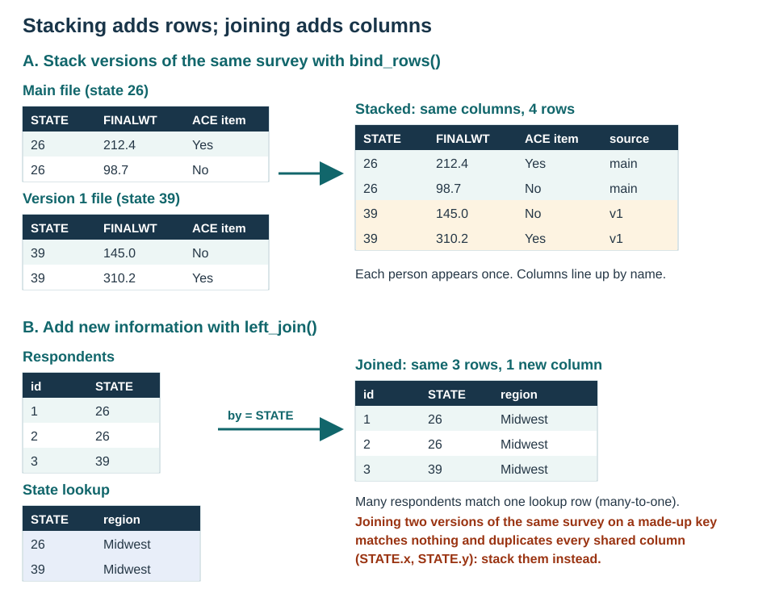

# Data Engineering: Stacking and Joining {#sec-engineering}

```{r}
#| label: setup
source("chapters/survey/_common.R")
brfss_file <- file.path(processed_dir, "01-brfss.rds")
brfss <- readRDS(brfss_file)

# Optional files for the stacking example (see "Download the version files" below).
version_files <- c(
  main = "LLCP2024.XPT",
  v1 = "LLCP24V1.XPT",
  v2 = "LLCP24V2.XPT"
)
have_versions <- all(file.exists(file.path(raw_dir, version_files)))

# Run every SQL example on SQLite, as in the data-preparation chapter.
options(sqldf.driver = "SQLite")
# Use sqldf's R-based string processing without a Tcl/Tk display dependency.
options(gsubfn.engine = "R")
```

## Overview

::: {.callout-note collapse="false" title="Two ways to combine data, for two different jobs"}

Survey analyses often need more than one file. Before writing any code, ask what the new
file adds:

- **More people, with the same variables.** Several questionnaire versions of the same
  survey, several survey years, or several sites. These files are **stacked**: their rows
  are placed one under the other with `dplyr::bind_rows()`, and their columns are lined up
  by name.
- **More variables, for the same people (or places).** A table of state names and regions,
  area-level measures for each county, or a second instrument completed by the same
  respondents. These files are **joined**: their columns are added side by side with
  `dplyr::left_join()`, matching rows on a key.

@fig-stack-join shows the difference.

{#fig-stack-join width="100%" fig-alt="Panel A stacks a main-file table and a version-1 table with the same three columns into one four-row table with a source column. Panel B left-joins a three-row respondent table to a two-row state lookup by STATE, keeping three rows and adding a region column."}

Using a join where a stack is needed is a common mistake. If two questionnaire versions
are joined on an identifier that never matches (for example, a key built as
`paste(SEQNO, 1)` in one file and `paste(SEQNO, 2)` in the other), a full join keeps every
row but treats each shared column as a different variable, so the result has `STATE.x`,
`STATE.y`, and so on. Stacking the files gives one `STATE` column.

The data-preparation chapter walks through all six kinds of joins with small tables
(@fig-joins). This chapter applies the two most common operations to BRFSS:

1. stacking the BRFSS questionnaire version files to analyze an optional module asked in
   different states on different versions;
2. a left join that adds state names and Census regions to every respondent.

:::

## Stacking questionnaire versions {#sec-stacking}

### Why BRFSS has version files

Every state asks the BRFSS **core** questions. States can also add **optional modules**,
such as the Adverse Childhood Experiences (ACE) module, and some states split their
sample across up to three **questionnaire versions** so that they can ask more modules,
each of a part of their sample. CDC therefore releases:

- the **main (combined) file**, with every respondent, the core questions, and the
  modules a state asked on all of its versions, weighted with `_LLCPWT`;
- one **version file** for each questionnaire version (`LLCP24V1.XPT`, `LLCP24V2.XPT`,
  and so on), with the respondents who received that version, the modules asked on it,
  and a weight for that version (for example, `_LCPWTV1`).

To analyze a module, you need the respondents from every state that asked it, and each
state's respondents must come from the file in which it asked the module. That means
stacking the pieces, each with its own weight. CDC explains the rules, with worked
examples, in *Complex Sampling Weights and Preparing Module Data for Analysis*, published
with each year's data on the
[CDC BRFSS annual data page](https://www.cdc.gov/brfss/annual_data/annual_data.htm).
Read the version for your survey year before you start.

### Download the version files (optional)

The rest of the book uses only the main file. To run this section, download the SAS
transport files for questionnaire versions 1 and 2 from the
[CDC BRFSS 2024 page](https://www.cdc.gov/brfss/annual_data/annual_2024.html), unzip
them, and save them in `data/brfss/raw/` as `LLCP24V1.XPT` and `LLCP24V2.XPT`. If the
files are not there, the code in this section is shown but not run.

```{r}
#| label: version-files-status
#| echo: false
#| results: asis
if (!have_versions) {
  cat(
    "::: {.callout-warning}\nThe questionnaire version files are not in",
    "`data/brfss/raw/`, so the code in this section was not run when this page",
    "was built.\n:::\n"
  )
}
```

### Step 1: Read each file with the same column names

To stack files, their columns must have the same names. Three things differ between the
BRFSS files and are fixed as each file is read:

- **Underscore names.** `_STATE`, `_STSTR`, and `_PSU` need backticks in every line of
  code. Renaming them once (to `STATE`, `STSTR`, `PSU`) avoids that.
- **The weight.** Each file has its own weight variable. Renaming each one to `FINALWT`
  lines the weights up in one column when the files are stacked.
- **The module.** A module's items are only in the files where it was asked. Reading
  with `dplyr::any_of()` takes the item when it is there, and the function adds an empty
  column when it is not.

Set `module_item` to one item from the module you want to analyze. The ACE item used
here is an example: check the 2024 codebook for the item you need and its name.

```{r}
#| label: read-versions
#| eval: !expr have_versions
#| cache: true
module_item <- "ACEDEPRS" # one item from your module (check the codebook)
version_weights <- c(main = "_LLCPWT", v1 = "_LCPWTV1", v2 = "_LCPWTV2")

read_version <- function(source) {
  path <- file.path(raw_dir, version_files[[source]])
  weight <- version_weights[[source]]
  # Check: the weight we expect is in this file (read only the column names).
  if (!weight %in% names(haven::read_xpt(path, n_max = 0))) {
    stop(weight, " is not in ", path, ". Check the codebook for this file.")
  }
  data <- haven::read_xpt(
    path,
    col_select = dplyr::any_of(c(
      "SEQNO",
      "_STATE",
      "_STSTR",
      "_PSU",
      weight,
      module_item
    ))
  ) |>
    dplyr::rename(
      STATE = `_STATE`,
      STSTR = `_STSTR`,
      PSU = `_PSU`,
      FINALWT = dplyr::all_of(weight)
    ) |>
    dplyr::mutate(source = source)
  if (!module_item %in% names(data)) {
    data[[module_item]] <- NA_real_ # module not in this file
  }
  return(data)
}

pieces <- purrr::map(names(version_files), read_version) |>
  purrr::set_names(names(version_files))
purrr::map_int(pieces, nrow)
```

### Step 2: Find which file each state asked the module in

A state asked the module in a file if its respondents in that file answered the item.
The table below shows, for each state and file, how many respondents there are and what
share answered the item.

```{r}
#| label: coverage
#| eval: !expr have_versions
coverage <- pieces |>
  purrr::map(\(piece) {
    piece |>
      dplyr::summarise(
        n = dplyr::n(),
        percent_answered = round(100 * mean(!is.na(.data[[module_item]])), 1),
        .by = c(STATE, source)
      )
  }) |>
  purrr::list_rbind() |>
  dplyr::filter(percent_answered > 0)
coverage |> dplyr::arrange(STATE, source)
```

The rule for choosing the rows follows from the file structure:

- A state with the module in the **main file** asked it of its whole sample. Take that
  state's respondents from the main file only, with `_LLCPWT`.
- Any other state asked the module on one or more versions. Take its respondents from
  each **version file** in which it asked the module, with that version's weight.

A state must never be taken from the main file and a version file at the same time,
because the version files hold the same people as the main file, and they would be
counted twice.

```{r}
#| label: choose-states
#| eval: !expr have_versions
states_main <- coverage |>
  dplyr::filter(source == "main") |>
  dplyr::pull(STATE)
states_v1 <- coverage |>
  dplyr::filter(source == "v1", !STATE %in% states_main) |>
  dplyr::pull(STATE)
states_v2 <- coverage |>
  dplyr::filter(source == "v2", !STATE %in% states_main) |>
  dplyr::pull(STATE)

# Check: no state is taken from the main file and a version file.
stopifnot(length(intersect(states_main, c(states_v1, states_v2))) == 0)
list(main = states_main, v1 = states_v1, v2 = states_v2)
```

::: {.callout-important title="Compare the lists with CDC's module table"}
The data show where the item was answered; CDC's module tables for the survey year say
where the module was asked. Before using the stacked data, check that the three lists
above agree with the module table. You can also type the lists in by hand from the table,
as Federal Information Processing Standards (FIPS) state codes, for example
`states_v1 <- c(26, 39)`, and keep the check above.
:::

### Step 3: Stack the pieces

```{r}
#| label: stack
#| eval: !expr have_versions
stacked <- dplyr::bind_rows(
  pieces$main |> dplyr::filter(STATE %in% states_main),
  pieces$v1 |> dplyr::filter(STATE %in% states_v1),
  pieces$v2 |> dplyr::filter(STATE %in% states_v2)
)

# Check: a state comes from one source only, unless it asked the module on more than
# one version.
stacked |> dplyr::count(STATE, source)
```

### Step 4: Adjust the weights for states with more than one version

Each version's weight makes that version's respondents represent the **whole** adult
population of the state. A state that asked the module on two versions is therefore
represented twice, once by each version's respondents. To count it once, multiply each
version's weights by that version's share of the state's stacked sample, so that the
shares within each state add up to 1:

$$
\text{FINALWT\_ADJ} = \text{FINALWT} \times
\frac{n_\text{version in the state}}{n_\text{all versions in the state}}
$$

States that come from a single file have a share of 1, so their weights are unchanged.
If the versions are of similar size, CDC's guidance also allows a constant (0.5 for two
versions, about 0.33 for three).

```{r}
#| label: adjust-weights
#| eval: !expr have_versions
stacked <- stacked |>
  dplyr::add_count(STATE, name = "n_state") |>
  dplyr::add_count(STATE, source, name = "n_version") |>
  dplyr::mutate(FINALWT_ADJ = FINALWT * n_version / n_state)

# Check: within every state, the version shares add up to 1.
shares <- stacked |>
  dplyr::distinct(STATE, source, n_version, n_state) |>
  dplyr::summarise(total_share = sum(n_version / n_state), .by = STATE)
stopifnot(isTRUE(all.equal(shares$total_share, rep(1, nrow(shares)))))
dplyr::filter(stacked, n_version < n_state) |>
  dplyr::distinct(STATE, source, n_version, n_state)
```

Make the adjustment **right after stacking**, before you drop any rows for missing
answers or select a subgroup, so that the shares describe each version's full sample in
the state.

### Step 5: Declare the survey design

The stacked data use the adjusted weight with the same strata and PSUs as before.
`nest = TRUE` tells the survey package that PSU codes repeat across strata.

```{r}
#| label: stacked-design
#| eval: !expr have_versions
stacked_design <- stacked |>
  srvyr::as_survey_design(
    ids = PSU,
    strata = STSTR,
    weights = FINALWT_ADJ,
    nest = TRUE
  )
stacked_design
```

From here, the module is analyzed exactly as the rest of this part of the book analyzes
the main file: clean and recode the items (@sec-cleaning), then describe and model them
with the design.

## Joining a lookup table {#sec-lookup-join}

BRFSS stores each respondent's state as a FIPS code (`_STATE`): 26 is Michigan and 39 is
Ohio. A small lookup table, `data/lookup/states.csv`, gives each code a name, a postal
abbreviation, and a US Census Bureau region. A **left join** adds those columns to every
respondent and keeps every respondent, whether or not their code is in the lookup.

### Step 1: Import the lookup table and check its key

The key is the column the join matches on. In the lookup, each code must appear exactly
once; otherwise a respondent would match two rows and be duplicated (see the one-to-many
example in the data-preparation chapter).

```{r}
#| label: import-lookup
states <- utils::read.csv(
  "data/lookup/states.csv",
  colClasses = c(
    fips = "numeric",
    state_name = "character",
    state_abbr = "character",
    census_region = "character"
  )
)
# Check: one row per FIPS code, and no blank keys.
stopifnot(!anyNA(states$fips), !anyDuplicated(states$fips))
nrow(states)
utils::head(states)
```

### Step 2: Look for codes that will not match

An **anti join** returns the rows of the first table that have no match in the second.
Run it in both directions before joining.

```{r}
#| label: unmatched
# Respondents whose state code is not in the lookup: these would get blank names.
no_lookup <- dplyr::anti_join(
  brfss,
  states,
  by = dplyr::join_by(`_STATE` == fips)
)
nrow(no_lookup)

# Lookup rows with no respondents: harmless, but worth knowing.
dplyr::anti_join(
  states,
  dplyr::distinct(brfss, `_STATE`),
  by = dplyr::join_by(fips == `_STATE`)
)
```

Every respondent's code is in the lookup. The lookup has one row with no respondents:
Tennessee, which is not in the 2024 data (@sec-import).

### Step 3: Join

`relationship = "many-to-one"` states what we expect: many respondents share one state,
and each state has one lookup row. If that is not true, `dplyr` stops with an error
instead of quietly adding rows.

::: {.panel-tabset}

## dplyr

```{r}
#| label: left-join-dplyr
brfss_joined <- brfss |>
  dplyr::left_join(
    states,
    by = dplyr::join_by(`_STATE` == fips),
    relationship = "many-to-one"
  )

# Check: the same respondents, and every one has a state name.
stopifnot(
  nrow(brfss_joined) == nrow(brfss),
  !anyNA(brfss_joined$state_name)
)
brfss_joined |> dplyr::count(census_region)
```

## SQL

```{r}
#| label: left-join-sql
# SQL needs double quotes around names that start with an underscore.
region_counts_sql <- sqldf::sqldf(
  'SELECT s.census_region, COUNT(*) AS n
   FROM brfss AS b
   LEFT JOIN states AS s ON b."_STATE" = s.fips
   GROUP BY s.census_region
   ORDER BY s.census_region'
)
region_counts_sql
```

:::

```{r}
#| label: compare-sql-dplyr
# Check: the dplyr and SQL joins give the same counts.
region_counts_dplyr <- brfss_joined |>
  dplyr::count(census_region, name = "n") |>
  dplyr::arrange(census_region)
stopifnot(
  identical(region_counts_dplyr$census_region, region_counts_sql$census_region),
  identical(as.numeric(region_counts_dplyr$n), as.numeric(region_counts_sql$n))
)
```

::: {.callout-tip title="Joining area-level data"}
The same steps work for any table with one row per place: county poverty rates from the
American Community Survey, state policy indicators, and so on. Check the key, look for
unmatched codes in both directions, state the relationship, and confirm the row count
afterwards. Survey weights describe people, not places, so the joined columns are
analyzed as characteristics of each respondent's state.
:::

## Save for the next chapter

```{r}
#| label: save
saveRDS(brfss_joined, file.path(processed_dir, "02-brfss-joined.rds"))
```

## Practice

1. In the stacking example, what would go wrong if Michigan were taken from both the
   main file and the version 1 file?
2. Why must the weights be adjusted before rows with a missing module answer are
   dropped?
3. You receive a county table with two rows for one county (an old and a new name). What
   would the `relationship = "many-to-one"` argument do, and how would you fix the
   lookup?

::: {.callout-tip collapse="true" title="Suggested answers"}
1. Michigan's version 1 respondents are also in the main file, so they would be counted
   twice, and Michigan would represent about twice its adult population.
2. The shares should reflect each version's full sample in the state. Dropping rows
   first makes the shares depend on who answered, which changes the weights in a way
   the survey design does not intend.
3. `dplyr` would stop with an error, because some respondents would match two lookup
   rows. Keep one row per county code in the lookup (for example, the current name) and
   check `anyDuplicated()` again before joining.
:::
